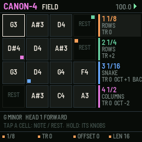
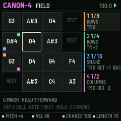
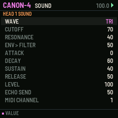

# CANON-4

One phrase, four playheads, for the M-VAVE FM-1. One of six sequencer firmwares built from a survey of sequencer archetypes (see the companion survey). Built on fm1-base; makes its own sound and sends MIDI.

## What it is for

**Archetype:** Multi-playhead / Cartesian: Fugue Machine, PolyPhase, Make Noise Rene.

CANON-4 turns one short phrase into counterpoint. Sixteen cells (a 4 x 4 field of scale degrees and
rests, on the white keys) are read by four playheads at once, each at its own rate and direction, along its own path
through the field (rows, columns, a snake, diagonals, a spiral, at random), from its own offset and length, transposed
by its own degrees and played by its own sound. The same tune a third above at half speed, backwards an octave up, a
slow bass on the columns: one edit and every voice hears it. The heads drift apart and meet again every few bars, so
the variation always resolves.

## What it does

- 16 cells: degree, note or rest, velocity, chance, length.
- 4 heads: rate 1/32..1/2, direction, path (6), offset, length 1-16, transpose in degrees, octave, sound, mute.
- Heads meet again every N bars (or run free); FX or black key 11 re-syncs now.
- Tap a cell key: note or rest; hold it: the knobs are the cell.
- REC: the keys write the cells one after another; dice with undo; key and scale with SEL.
- The screen: the field with each head's position as a coloured corner, and the four heads' settings.

## The controls

Hold any button alone for a second for its help card on the screen.

| Control | What it does |
| --- | --- |
| white keys | cells: tap note / rest; hold, then K1-K4: pitch, velocity, chance, length |
| black keys 1-4 | the head (GLO held: mute) |
| black keys 5-10 | the head's path |
| black key 11 | re-sync |
| K1-K4 (nothing held) | rate, transpose, offset, length of the head |
| PRESETS | the head's direction |
| ALGO | the head |
| SELECT | tempo |
| REC | keys write the cells |
| ARP / SEQ | dice / undo |
| FX | re-sync |
| LFO | mute the head |
| EDIT / GLO / HOME | SOUND / SETUP / the field |
| OCT | the head's octave |

Common to all six: PLAY starts and stops, SAVE saves to the project slot, OCT- / OCT+ the octave.

## Screens

  

## Build, test, install

The firmware is built with [fm1-base](https://github.com/charlesvestal/fm1-base) (vendored in `base/`) and JieLi's
toolchain, which runs in Docker on macOS (`colima start` first). Python 3.11 with Pillow.

    ./build.sh --host              # the host simulator, then every test in app/tests/
    ./build.sh --shots             # the screenshots in app/docs/img/
    ./build.sh                     # a development package: app/build/canon-4.fwsc
    ./build.sh --release 0.1       # a release package: app/build/canon-4-0.1.fwsc

Install over USB with fm1-base's installer (the FM-1 connected, Python with `python-rtmidi`):

    python3.11 base/tools/fm1_install.py app/build/canon-4-0.1.fwsc

Keep M-VAVE's stock firmware and M-UPGRADE at hand: the installer can put the stock firmware back.

## Layout

| Path | What |
| --- | --- |
| `app/seq.c` | the sequencer: its data and the engine (runs inside the audio render, sample-exact) |
| `app/ui.c` | the controls and the screen |
| `app/app.c`, `app/app.h` | the contract with fm1-base |
| `app/core/` | shared with the five sibling firmwares: synth (8 voices, 11 drums, echo), transport and MIDI clock, project slots, controls kit, text |
| `app/tests/` | host-simulator scripts: `basic.txt` (behaviour) and `screens.txt` (pictures) |
| `app/fm1.toml` | build settings, package identity `FM-1_26`, firmware.json fields |
| `base/` | fm1-base and felucca-bsp, vendored (MPL-2.0) |

## Common to all six

- Its own sound: an 8-voice synth (saw, square, triangle, sine, noise, super-saw; resonant filter; ADSR; glide),
  eleven synthesised drums on General MIDI notes, and a shared echo. Every part also goes out as MIDI (its channel set
  on its sound page) over USB and Bluetooth MIDI.
- MIDI clock: INTERNAL (and send clock, start, stop) or FOLLOW an incoming clock. MIDI notes in play the part shown.
- Four project slots (SETUP / GLO page). SAVE while playing saves at the stop.
- Hold any button alone for a second: a help card explains it.

## Status

**0.1, untested on hardware.** It builds for the FM-1, passes its host-simulator tests, and its screens are taken
from the simulator. Nothing has been run on a real FM-1 yet; CPU load of the synth on the device is not measured.

## Licence

MPL-2.0, as fm1-base. After Fugue Machine (Alexandernaut), PolyPhase and Make Noise's Rene.

You can also try Canon 4 in the browser, no flashing needed, in the free community [FM-1 Emulator](https://fm1-emulator.atst.tools/).
