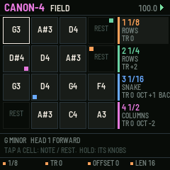
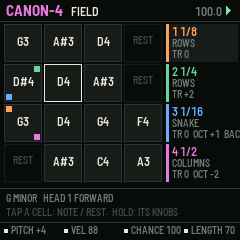
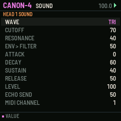

# CANON-4

One phrase, four playheads, for the M-VAVE FM-1. One of six sequencer firmwares built from a survey of sequencer archetypes (see the companion survey). Built on fm1-base; makes its own sound and sends MIDI.

## What it is for

**Archetype:** Multi-playhead / Cartesian: Fugue Machine, PolyPhase, Make Noise Rene.

CANON-4 turns one short phrase into counterpoint. Sixteen cells (a 4 x 4 field of scale degrees and
rests, on the white keys) are read by four playheads at once, each at its own rate and direction, along its own path
through the field (rows, columns, a snake, diagonals, a spiral, at random), from its own offset and length, transposed
by its own degrees and played by its own sound. The same tune a third above at half speed, backwards an octave up, a
slow bass on the columns: one edit and every voice hears it. The heads drift apart and meet again every few bars, so
the variation always resolves.

## What it does

- 16 cells: degree, note or rest, velocity, chance, length.
- 4 heads: rate 1/32..1/2, direction, path (6), offset, length 1-16, transpose in degrees, octave, sound, mute.
- Heads meet again every N bars (or run free); FX or black key 11 re-syncs now.
- Tap a cell key: note or rest; hold it: the knobs are the cell.
- REC: the keys write the cells one after another; dice with undo; key and scale with SEL.
- The screen: the field with each head's position as a coloured corner, and the four heads' settings.

## The controls

Hold any button alone for a second for its help card on the screen.

| Control | What it does |
| --- | --- |
| white keys | cells: tap note / rest; hold, then K1-K4: pitch, velocity, chance, length |
| black keys 1-4 | the head (GLO held: mute) |
| black keys 5-10 | the head's path |
| black key 11 | re-sync |
| K1-K4 (nothing held) | rate, transpose, offset, length of the head |
| PRESETS | the head's direction |
| ALGO | the head |
| SELECT | tempo |
| REC | keys write the cells |
| ARP / SEQ | dice / undo |
| FX | re-sync |
| LFO | mute the head |
| EDIT / GLO / HOME | SOUND / SETUP / the field |
| OCT | the head's octave |

Common to all six: PLAY starts and stops, SAVE saves to the project slot, OCT- / OCT+ the octave.

## Screens

## Install

Use the [installer page](../install/) in Chrome or Edge with the FM-1 connected by USB. Keep M-VAVE's stock firmware
and M-UPGRADE at hand: the installer can put it back. To build it yourself, see the
[source](https://github.com/davidpryan/canon-4).

## Status

0.1, untested on hardware. It builds for the FM-1 and passes its host-simulator tests; nothing has been run on a real
FM-1 yet.
